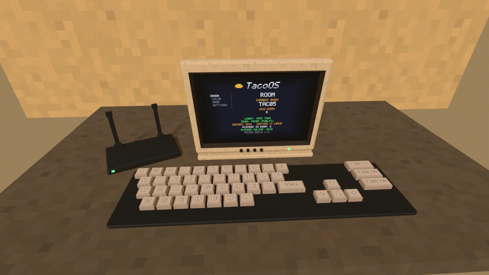
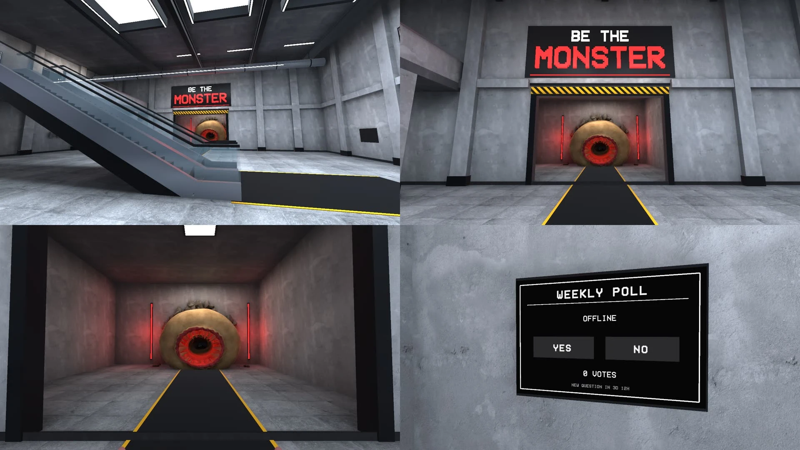

# Learn AI

here's a full guide on how to learn ai based off of **what i use it for and how i use it**. this is mainly for people who want to get into vibe coding, work on games, websites, software, etc.

i'll probably throw in some add-ons here and there whenever something new comes out, so don't mind haha.

[already good at ai? go pro](pro)

## Anthropic — Claude Code {#claude-code}

### what is claude code?

claude code is basically a **coding agent made by anthropic that has access to your project**. instead of going on claude's website and constantly copying and pasting code, claude code can directly work on your project, run commands, fix bugs, create files, etc.

this is what i mainly use for working on games and other projects.

### what plan do i get?

depends on what you're using claude for.

if you're just working on small projects or trying to learn how to vibe code, **claude pro should be fine**.

if you're trying to spend an entire month working on a game without constantly worrying about usage, i'd recommend looking into claude max 5x.

it really depends on what models you're using, what reasoning effort you're using and how much you're actually working.

**don't go spending $200 on an ai plan when you don't even know what you're going to use it for** lmao.

### what models do i use?

- **opus:** mainly for working on bigger projects, complicated systems, debugging, planning, etc.
- **sonnet:** pretty good for normal coding tasks and not wasting as much usage on smaller things.
- **haiku:** i'd mainly use this for extremely simple tasks.

**you don't need to use opus on high reasoning just to change the color of a button.**

**resources:**

https://claude.com/

https://claude.com/product/claude-code

## OpenAI — Codex {#codex}

codex is another coding agent, but it's made by openai.

i'd recommend trying out codex if you already have a chatgpt subscription since you might already have access to it.

something you can also do is **have claude work on something and then have codex review what claude did**, find bugs, fix stuff, etc.

you don't have to be dedicated to one ai company. just use whatever actually works better for what you're doing.

**resource:**

https://chatgpt.com/codex

## Other Coding Agents {#other-agents}

there's a lot more coding agents than just claude code and codex.

### some i'd recommend looking into

- opencode
- cursor
- gemini cli
- github copilot

opencode is pretty interesting because **you can use multiple ai providers under one coding agent**. you can also connect your own local models to it through something like ollama.

if you're someone who likes experimenting with different models like i do, i'd definitely look into opencode.

**resource:**

https://opencode.ai/

## Difference Between Plugins and Skills {#plugins-skills}

### what is a skill?

a skill is a set of instructions for your coding agent, usually a folder with a `SKILL.md` file, sometimes with scripts or examples. the agent loads it when the task calls for it.

### what is a plugin?

a plugin is a package you install. it can bundle skills, slash commands, subagents, hooks and mcp servers together.

**a skill teaches your agent how to do something. a plugin is a way to install a bunch of that stuff at once.**

**resources:**

https://code.claude.com/docs/en/skills

https://code.claude.com/docs/en/plugins

## Where to Find MCP Servers {#mcp-servers}

mcp servers connect your coding agent to other apps and tools, like blender, unity or roblox studio.

### places to look

https://registry.modelcontextprotocol.io/

https://github.com/modelcontextprotocol/servers

https://github.com/mcp

https://smithery.ai/

https://glama.ai/mcp/servers

https://www.pulsemcp.com/

**check who made an mcp server before you install it.** it can get access to your files and accounts.

## Grok Bot - Best Thing to Use {#grok-bot}

**grok bot is an ai teammate from xai.** bots get their own cloud computer, sign in to your tools and take on projects from start to finish.

they can keep running while your laptop is closed, and can join slack, microsoft teams and video calls. check the official page for current plans and pricing.

**resource:**

https://x.ai/bot

## AI Models {#models}

for people who don't understand the difference between an ai model and a coding agent:

**claude code is the coding agent, opus is the model.**

the coding agent is what gives the model access to tools and allows it to actually work on your project.

here's some ai companies and model families i'd recommend looking into.

- anthropic: opus, sonnet, haiku
- openai: gpt
- google: gemini, gemma
- alibaba: qwen
- deepseek: deepseek
- z.ai: glm
- moonshot ai: kimi
- meta: llama and muse
- mistral ai: mistral

there's a lot more than this, but these are some good ones to start researching.

also, just because you've never heard of a model doesn't mean it's bad. there's some really good models outside of openai and anthropic.

## Models for 2D Assets {#assets-2d}

icons, ui, concept art, textures, sprites, thumbnails, etc.

*checked november 28, 2026.*

### paid

- **gpt image 2.6** (openai): at or near the top of the image leaderboards right now. what i'd try first.
- **nano banana 2.1** (google): close behind and cheaper.

### local

- **z-image-turbo:** fast, fits on a 16gb graphics card, apache 2.0.
- **flux.2 klein 4b:** good for mid-range graphics cards, apache 2.0.
- **hidream-o1-image:** 8b, around 10gb of vram, mit license.

for pixel art and sprite sheets, expect to clean things up yourself in something like aseprite.

**check the license before you ship it.** some open models, like flux.2 klein 9b and qwen-image-2.1, are non-commercial.

https://chatgpt.com/

https://gemini.google/overview/image-generation/

https://github.com/Tongyi-MAI/Z-Image

https://huggingface.co/black-forest-labs

https://huggingface.co/HiDream-ai

https://www.aseprite.org/

## Models for 3D Assets {#assets-3d}

there's two ways to do this: generate the mesh, or have a coding agent build it in blender.

### image to 3d (paid)

- **meshy 7.1:** a good all-rounder for game assets.
- **tripo:** good value for game-ready stuff.
- **rodin gen-2.5:** cleaner topology if you're going to keep editing the mesh.

### image to 3d (local)

- **trellis.2** (microsoft): mit license, needs a 24gb nvidia gpu. check the mesh for small holes.
- **hunyuan3d 2.1** (tencent): open weights you can run yourself. read its license first.

### agents in blender

hook a coding agent up to blender through mcp. [my model picks are on the pro page](pro#models-3d).

whatever you use, **check the triangle count, scale and textures** before putting it in your game.

https://www.meshy.ai/

https://www.tripo3d.ai/

https://hyper3d.ai/

https://github.com/microsoft/TRELLIS.2

https://github.com/Tencent-Hunyuan/Hunyuan3D-2.1

https://www.blender.org/

## AI Benchmarks {#benchmarks}

### how do i know which model is better?

https://artificialanalysis.ai/

i use artificial analysis to look at models, compare benchmarks, intelligence, coding capabilities, speed, pricing, etc.

some stuff you should look into:

- intelligence index
- coding agent index
- swe-bench
- terminal-bench
- tokens per second
- time to first token
- context window

don't just look at the #1 model on a benchmark and assume it's going to be the best at everything.

a model could perform insanely well on a benchmark and still do a terrible job working on your specific project.

**actually test the models yourself.**

[see live benchmarks](pro#benchmarks)

## AI Plans and Subscriptions {#plans}

### what ai plans should i get?

here's what i'd personally look into depending on what you're doing.

### just getting started

- free ai models
- free usage on coding agents
- local ai models

### working on small to medium projects

- claude pro
- chatgpt plus
- google ai pro

### working on bigger projects daily

- claude max 5x
- higher-usage plans
- multiple ai providers if you can afford it

**you don't need all of these subscriptions at once** btw.

look at the actual usage you're getting out of your current plan before deciding to upgrade.

also check the official pricing pages since ai companies are constantly changing their plans and usage limits.

## Local AI {#local-ai}

something i feel like a lot of people don't know is that **you can literally run ai models on your own computer**.

you don't necessarily need to pay for an ai subscription to use ai.

i'd recommend getting ollama or lm studio if you're interested in experimenting with local models.

### what models should i look into?

*checked november 28, 2026. this stuff changes constantly.*

- **inkling 2 mini** (thinking machines): about 26b total with around 3.4b active at a time. the company says it needs about 20gb of memory. apache 2.0.
- **inkling 2 small:** 594b total, about 17b active. the weights are open, but "small" is doing a lot of work here. you're not running this on a normal pc.
- **qwen 3.8 27b:** a solid pick if you have around 24gb of vram. apache 2.0.
- **qwen 4:** qwen4-max is hosted only. alibaba says smaller open-weight versions are coming, but hasn't given a date.
- **gemma 4:** the 12b is a good one to try on 8 to 12gb graphics cards.
- **glm-5.3-flash:** open weights, but around 320b. too big for most setups.
- deepseek, llama and mistral are worth watching too.

obviously, **what models you can run depends on your pc specs**.

you can't just download a massive model and expect it to run smoothly on a computer with 8gb of ram.

https://thinkingmachines.ai/news/inkling-2-mini/

https://huggingface.co/thinkingmachines/Inkling-2-Small

https://ollama.com/library/qwen3.8

https://ollama.com/library/gemma4

### what does 4b, 8b, 14b, etc. mean?

the **b stands for billion parameters**.

an 8b model has approximately 8 billion parameters.

more parameters doesn't always mean the model is smarter. architecture, training data, quantization and a bunch of other stuff matter too.

### what is quantization?

you'll probably see stuff like q4, q5, q8 and gguf when looking into local models.

quantization basically **reduces the precision of the model's weights so it doesn't require as much memory** to run.

gguf is a file format commonly used for running local models.

if you don't have a dedicated gpu, i'd recommend experimenting with smaller quantized models first.

**resources:**

https://ollama.com/

https://lmstudio.ai/

https://huggingface.co/models

## Reasoning Effort {#reasoning}

depending on what model you're using, you might have different reasoning levels.

- low
- medium
- high
- extra high (xhigh)

higher reasoning effort generally allows the model to spend more time reasoning through your task.

**that doesn't mean you should constantly be using xhigh for everything.**

if you're working on a complicated multiplayer system or trying to figure out why something in your game is extremely buggy, higher reasoning might be useful.

if you're just changing some text on a ui, there's really no reason to waste that much usage.

## Context Windows {#context}

you'll probably hear a lot of people talking about context windows when new models come out.

a context window is basically **how much information the model can process within an interaction**.

this includes your messages, code, files, tool outputs, etc.

just because a model has a massive context window doesn't mean you should throw your entire project at it and expect it to understand everything perfectly.

keep your conversations organized and start new sessions when necessary.

i'd also recommend **having documentation inside your project** so your coding agent can understand what you've been working on without having to explain everything again.

## Prompt Engineering {#prompts}

**please actually explain what you want your ai to do.**

one of the biggest mistakes i see people make is giving claude a prompt like:

> "make me a basketball game."

and then getting mad when the game looks terrible.

tell the model what you're working on, what systems you want implemented, what platform you're developing for, how you want everything to look, etc.

### stuff i'd include in my prompts

- what i'm trying to accomplish.
- what needs to be implemented.
- what needs to be fixed.
- visual references.
- what the ai shouldn't touch.
- how the ai should test its work.

i use a lot of **images and videos as references** whenever i'm working on ui, environments, player models, etc.

especially when working on games, don't expect ai to just know exactly what you're imagining.

if something looks bad, **explain why it looks bad** rather than constantly telling the ai to redo it.

you'll probably save yourself a decent amount of usage doing this too.

## Vibe Coding Games {#games}

if you're trying to get into game development using ai, here's some stuff i'd recommend looking into.

### game engines

- unity
- unreal engine
- godot
- roblox studio

i mainly use unity because i work on vr games.

### other resources

- blender — 3d modeling.
- fab — game assets, environments, materials, etc.
- unity asset store — unity assets and systems.
- github — open-source projects and version control.

don't make ai generate literally every single thing in your game.

there's already a bunch of resources available online that you can use, assuming the license allows you to.

also, **please test your game yourself.**

claude could tell you that it fixed something, built your game successfully and that everything is working perfectly, just for you to get on the game and realize half the stuff doesn't work properly lmao.

**a successful build doesn't mean your game is bug-free.**

work on individual systems rather than trying to make an entire game in one prompt.

### for example, if you're making a basketball vr game

1. player rig and movement.
2. basketball physics.
3. gripping and dribbling.
4. shooting mechanics.
5. multiplayer.
6. ui and environments.
7. optimization.

get the actual gameplay working before worrying about a bunch of unnecessary features.

## Showcase - What I've Built With AI {#showcase}

**Computer:** TacoOS Computer for my game. — *Opus 5.5*

**Taco:** Cartoony Taco Item for my game. — *Opus 5.5 and Sonnet 5.5*

**Shark:** Custom Shark Model — *Opus 5.5*

Player Model for VR — *Opus 5.5*

Basketball Court — *Opus 5.5 and GPT 6.2 Sol*

Be The Monster — *Opus 5.5 and GPT 6.2 Astra*

### websites

https://www.brickyard.ch/ Sonnet 5.5 and OpenCode's free models

https://codersocial.com/ Sonnet 5.5 and GPT 6.1 Sol (this was a while ago haha)

More Soon!

## GitHub and Version Control {#github}

please learn how to use github if you're going to vibe code.

there will eventually be a point where your coding agent completely breaks something that was working perfectly fine before.

having version control allows you to go back to previous versions of your project rather than spending another 2 hours trying to fix something that didn't need fixing in the first place.

### some stuff you should learn

- repositories
- commits
- branches
- pull requests
- merging
- reverting

**always commit your project before asking ai to make a massive change.**

also, **don't be uploading your api keys and passwords to public repositories.**

**resource:**

https://github.com/

## How Do I Stay Up to Date With AI? {#up-to-date}

x (twitter).

a lot of the information i get about ai comes from x. new model releases, benchmarks, research, coding agents, leaks, etc.

i'd recommend following ai companies, researchers, engineers and other people who are actually involved in the ai space.

**some accounts i'd recommend:**

https://x.com/OpenAI

https://x.com/AnthropicAI

https://x.com/GoogleDeepMind

https://x.com/huggingface

https://x.com/ArtificialAnlys

**you can also use:**

https://artificialanalysis.ai/

https://huggingface.co/

https://github.com/

https://arxiv.org/

don't believe every random benchmark or model leak you see on x either. people post some ridiculous stuff on there sometimes.

**ai moves extremely fast.** the model you're using today could be completely outperformed by another model a few months from now.

just stay updated and experiment with stuff.

## Final Thoughts {#final-thoughts}

you don't need to know everything about ai to start working on projects.

i'm still learning a bunch of stuff myself, and that's partially why i'm making this document.

don't be afraid to experiment with different models, coding agents, local ai, etc.

also, **try to actually learn what your ai is doing** rather than just accepting every single thing it does.

you don't need to be some senior software engineer to make something cool, but understanding your own project will save you from a lot of problems later on.

**just build stuff, learn from it and keep going.**

— isaiah boyd
